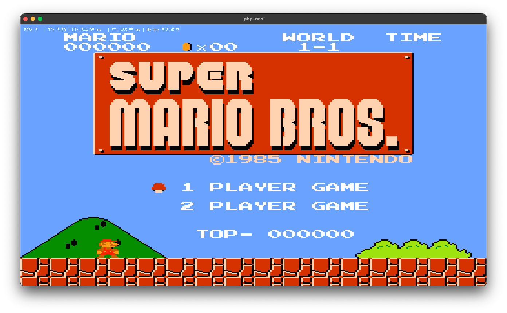

# php-nes: NES Emulator in PHP with PHP-GLFW and VISU

[](https://github.com/oliverearl/nes-php-glfw/actions/workflows/tests.yml)
[](https://github.com/oliverearl/nes-php-glfw/actions/workflows/static-analysis.yml)
[](https://github.com/oliverearl/nes-php-glfw/actions/workflows/code-style.yml)
[](https://www.php.net/)
[](LICENSE)

A Nintendo Entertainment System (NES) emulator written in PHP, implementing the 6502 CPU and PPU with instruction cycle accounting. It uses
the PHP-GLFW extension for OpenGL graphics rendering via the VISU framework. See [compatibility and accuracy limits](#compatibility-and-accuracy-limits)
for the supported hardware and remaining timing work.



## About

This is a technical demonstration project showcasing low-level emulation techniques in PHP. The emulator prioritises accuracy and clear hardware
modelling while keeping the runtime practical enough for experimentation with supported ROMs.

**This is a technical demo.** It is intended for educational purposes and as a proof-of-concept for emulation in PHP, not as a complete
production-ready NES emulator.

## Requirements

- **PHP 8.5+** (within PHP 8.x, as declared in `composer.json`)
- **PHP-GLFW extension** enabled in the CLI interpreter (required by Composer and the emulator)
- **Composer 2** (for dependency management)
- **A desktop display and OpenGL context** for the graphical application; headless tests and benchmarks do not open a window

### Critical Performance Note

**Disable Xdebug for best performance.** Running the emulator with Xdebug enabled will result in extremely poor performance. Ensure Xdebug is
disabled when running the emulator:

```bash
php -d xdebug.mode=off bin/start.php path/to/rom.nes
```

Or disable it in your `php.ini`:

```ini
xdebug.mode=off
```

## Installation

1. Clone the repository:
```bash
git clone https://github.com/oliverearl/nes-php-glfw.git
cd nes-php-glfw
```

2. Install and enable PHP-GLFW for the PHP CLI interpreter you will use. Follow the
[PHP-GLFW installation guide](https://phpgl.net/getting-started/getting-started-with-php-and-opengl.html) for your platform.

3. Install the locked dependencies:
```bash
composer install
```

Run Composer and the emulator with the same PHP interpreter. Keep development dependencies installed when running tests, static analysis,
or the generated benchmark fixtures. The repository includes the writable `var/cache/` and `var/storage/` directories; do not make them
world-writable.

## Usage

Run the emulator with a NES ROM file:

```bash
php bin/start.php path/to/rom.nes
```

If you don't start the emulator with a loaded ROM, it will display a graphical pattern. You
can also drag and drop a ROM file onto the window to load it.

### Frame Pacing

By default, the emulator prioritises smooth, accurate presentation over forcing wall-clock speed. If PHP cannot complete a full NES frame inside
the host frame budget, playback slows down and every completed NES frame is still presented. This keeps animation stable and avoids the emulator
doing expensive catch-up work for frames that would never reach the screen.

For heavily struggling systems, `--drop-frames` enables an experimental real-time pacing mode. VISU may run catch-up updates before drawing, and
only the latest completed NES frame is rendered. This can make wall-clock pacing more aggressive, but it may skip visible emulator frames:

```bash
php bin/start.php path/to/rom.nes --drop-frames
```

### Controls

- Arrow Keys: D-Pad
- Z: A Button
- X: B Button
- Enter: Start
- Backspace: Select

## Features

### Implemented

- **6502 CPU Emulation**
  - Official instructions and supported stable unofficial opcodes
  - Instruction cycle counts, branch/page-crossing penalties, and interrupt-entry cycles
  - Interrupt handling (NMI, IRQ)

- **PPU (Picture Processing Unit)**
  - Background rendering
  - Sprite rendering with priority
  - Proper VRAM and palette management
  - VBlank timing and interrupts

- **Memory Subsystem**
  - Accurate RAM mirroring
  - Memory-mapped I/O
  - Direct Memory Access (DMA) through the CPU address map
  - NROM cartridge RAM, trainer loading, and separate CHR-ROM/CHR-RAM handling

- **Input Handling**
  - Keyboard controls via VISU framework
  - Proper controller polling

- **Graphics**
  - OpenGL rendering via PHP-GLFW
  - Authentic NES colour palette
  - 256x224 resolution output

### Compatibility and Accuracy Limits

- Supported cartridges use legacy iNES headers and **NROM (mapper 0)**: 16 or 32 KiB PRG-ROM, 8 KiB CHR-ROM or CHR-RAM, horizontal or vertical
  nametable mirroring, and up to 8 KiB PRG-RAM. Other mappers, NES 2.0 headers, four-screen mirroring, and unsupported memory sizes are rejected.
- PRG-RAM is volatile; battery save files and save states are not implemented.
- Audio/APU, PAL timing, a second controller, physical gamepad mappings, configurable controls, and a pause/menu interface are not implemented.
- The CPU executes whole instructions. PPU rendering is based on scanlines/tile rows, with simplified sprite evaluation and sprite-zero hit.
  Complete CPU bus-cycle ordering, PPU dot timing, and hardware-accurate DMA stalls remain future work. Current frontend/benchmark DMA accounting
  uses a fixed 514 CPU cycles; [real OAM DMA](https://www.nesdev.org/wiki/DMA) takes 513 or 514 depending on alignment.
- Unsupported/unstable opcodes and CPU jam behaviour are not certified; some fall back to NOP behaviour.

Independent CPU vectors and regression tests improve confidence in the supported behaviour; they do not establish compatibility with the entire
NES library.

## Architecture

The emulator is structured around the actual NES hardware architecture:

- `src/Cpu/` - 6502 CPU implementation
- `src/Graphics/` - PPU and rendering pipeline
- `src/Bus/` - Memory buses and addressing
- `src/Cartridge/` - ROM loading and cartridge emulation
- `src/Input/` - Controller input handling
- `src/Emulation/` - Shared machine construction for graphical and headless callers
- `src/Benchmark/` - Headless frame execution, timing, checksums, and reporting

## Testing

The project includes unit and integration tests with PHPUnit. PHP-GLFW must be enabled, but the suite does not require a display.
HTML coverage additionally requires a compatible coverage driver such as Xdebug with `XDEBUG_MODE=coverage` or PCOV:

```bash
# Run all tests
composer test

# Run with Xdebug coverage enabled
XDEBUG_MODE=coverage composer test:coverage

# Run static analysis
composer phpstan

# Check code style
composer pint:check

# Preview automated refactoring suggestions
composer rector

# Apply refactorings, then format with Pint's PER preset
composer rector:fix

# Check formatting, static analysis, and refactoring suggestions without editing files
composer quality:check
```

## Development

See [CHANGELOG.md](CHANGELOG.md) for v1.1.0 changes and the
[maintainer release checklist](CONTRIBUTING.md#maintainer-release-checklist) for release validation.

This project follows strict code quality standards:

- **PHPStan** for static analysis
- **Laravel Pint** for code formatting (PER)
- **Rector** for PHP 8.5 upgrades, dead-code cleanup, type declarations, and PHPUnit improvements
- **PHPUnit** for unit/integration tests, independent CPU instruction vectors, and exhaustive binary ADC/SBC checks

Contributor guidance is available in [CONTRIBUTING.md](CONTRIBUTING.md). AI-assisted development guidelines are available in [AGENTS.md](AGENTS.md).

Optional [profiling and benchmarking tools](tools/README.md) are available for performance investigations. Their Python regression tests run separately:

```bash
python3 -m unittest discover -s tests/BenchmarkTools -v
```

The pinned independent CPU dataset and its validation limits are documented in
[the SingleStepTests fixture guide](tests/Support/Cpu/SingleStepTests/README.md). ROM-based integration tests may skip fixtures that are absent;
inspect the PHPUnit summary when validating a release.

Please do not submit copyrighted commercial ROMs in issues, pull requests, or test fixtures. Use synthetic ROMs, homebrew ROMs, or public test ROMs
with compatible redistribution terms if you must include ROM files.

## Technical Details

### Timing

- CPU: ~1.79 MHz (NTSC)
- PPU: 3x CPU speed
- Frame rate: ~60 FPS (262 scanlines per frame)

### Memory Map

- CPU Address Space: $0000-$FFFF
  - $0000-$07FF: 2KB internal RAM (mirrored)
  - $2000-$2007: PPU registers (mirrored)
  - $4000-$4017: APU and I/O registers (APU unimplemented)
  - $6000-$7FFF: Cartridge PRG-RAM when present
  - $8000-$FFFF: Cartridge ROM space

- PPU Address Space: $0000-$3FFF
  - $0000-$1FFF: Pattern tables
  - $2000-$2FFF: Nametables
  - $3F00-$3F1F: Palette RAM

## Resources

- [NES Dev Wiki](https://wiki.nesdev.com/)
- [6502 Reference](http://www.6502.org/)
- [PPU Documentation](https://wiki.nesdev.com/w/index.php/PPU)

## License

This project is distributed under the [MIT License](LICENSE). Third-party dependencies and fixtures retain their own licenses; see
[THIRD_PARTY_NOTICES.md](THIRD_PARTY_NOTICES.md) for attribution and fixture provenance.

## Acknowledgments

Built with the [VISU framework](https://github.com/phpgl/visu) for graphics rendering and the [PHP-GLFW](https://phpgl.net/) extension for OpenGL
bindings.

Inspiration and PHP reference was drawn from various PHP emulation projects, including:
- [This incredibly impressive Chip8 emulator using Visu and PHP-GLFW](https://github.com/mario-deluna/php-chip8)
- [A PHP emulator that renders to the terminal](https://github.com/hasegawa-tomoki/php-terminal-nes-emulator)
- [A similar Game Boy emulator that also renders to the terminal](https://github.com/gabrielrcouto/php-terminal-gameboy-emulator)
- [A Hello World ROM that is used as a test fixture](https://github.com/thomaslantern/nes-hello-world)

Nintendo, NES, Super Mario Bros, and related logos are trademarks of Nintendo. This project is not affiliated with or endorsed by Nintendo.
All trademarks and copyrights are the property of their respective owners.

**Do not distribute copyrighted ROMs!**

---

**Note:** This is a technical demonstration project. The focus is on accuracy, educational value, and readable hardware modelling rather than full
NES library compatibility.
Contributions and feedback are welcome.
